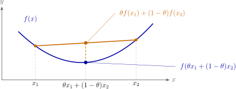

In reinforcement learning, the Bellman optimality operator takes a maximum over actions. Its contraction must bound the change in that maximum. Setting aside the RL-specific details, we want to prove the following inequality:

$\textbf{Claim:}$ Given two real-valued functions $f$ and $g$ defined on the same nonempty set $\mathcal{X}$ with finite maxima:

$$
\left|\max_{x \in \mathcal{X}} f(x)-\max_{x \in \mathcal{X}} g(x)\right|
\leq \max_{x \in \mathcal{X}} |f(x)-g(x)|.
$$

There are many ways to prove this inequality, this post uses a convexity argument. The proof is a direct application of Jensen's inequality, which states that the maximum of a convex combination of functions is less than or equal to the convex combination of their maxima.

## Jensen's Inequality

The commonly known form of Jensen's inequality is its expectation form. If $\psi$ is a convex function and $Z$ is a random variable with finite expectations, then

$$
\psi(\mathbb{E}[Z])\leq \mathbb{E}[\psi(Z)].
$$

Geometrically, the graph of a convex function lies below the line between any two points on the graph.^[This two-point interpolation is the definition of convexity. It is also a special case of Jensen's inequality. Jensen extends the relation to weighted averages of more points and to expectations over general random variables, when those expectations exist.]

<figure style="text-align: center;">
  
  <figcaption>For $0\leq\theta\leq1$, the line between two points on a convex graph lies on or above the graph.</figcaption>
</figure>

We can derive a midpoint form from this by setting $\theta = \frac{1}{2}$. Let $Z$ take the values $a$ and $b$ with equal probability. Then

$$
\psi\left(\frac{a+b}{2}\right)
\leq \frac{\psi(a)+\psi(b)}{2}.
$$

We will use this midpoint form to prove our inequality. Its inputs will be functions, and the convex operation will take their maximum values.

## Operator $\max_x$ is convex

We don't know that yet. So we will prove this first. Let $f$ and $g$ be real-valued functions on the same nonempty set $\mathcal{X}$. We define a functional^[A functional is a mapping from a space of functions to the real numbers.] $M$:

$$
M(h) := \max_{x\in \mathcal{X}} h(x).
$$

By the definition of $M$, for every $x\in\mathcal{X}$,
$$
  f(x) \leq M(f), \quad g(x) \leq M(g).
$$

For any $\lambda \in [0, 1]$, the weights $\lambda$ and $1-\lambda$ are nonnegative. Thus,
$$
\begin{aligned}
\lambda f(x) &\leq \lambda M(f), \\
(1-\lambda) g(x) &\leq (1-\lambda) M(g).
\end{aligned}
$$

Adding these two inequalities gives
$$
\lambda f(x)+(1-\lambda)g(x) \leq \lambda M(f)+(1-\lambda)M(g).
$$

This bound holds for every $x\in\mathcal{X}$. Take the maximum over $x$ on both sides. The expression on the right does not depend on $x$, so its maximum is the same value:

$$
\begin{aligned}
M(\lambda f+(1-\lambda)g)
&=\max_{x\in\mathcal{X}}\bigl(\lambda f(x)+(1-\lambda)g(x)\bigr) \\
&\leq \max_{x\in\mathcal{X}}\bigl(\lambda M(f)+(1-\lambda)M(g)\bigr) \\
&= \lambda M(f)+(1-\lambda)M(g).
\end{aligned}
$$

This shows that $M$ is convex. We can now apply the midpoint form of Jensen's inequality to $M$.

## Proof

Define $u=2(f-g)$ and $w=2g$.^[The convex object is $M$. Its input functions need no convexity condition. Thus, these choices of $u$ and $w$ are valid when the required maxima exist and are finite.] 

Then $f=\frac{(u+w)}{2}$. Applying the midpoint form of Jensen's inequality and the positive homogeneity^[For $\alpha\geq0$, multiplication by $\alpha$ preserves order. A point that maximizes $h$ also maximizes $\alpha h$. Thus, $M(\alpha h)=\alpha M(h)$.] of $M$ gives:

$$
\begin{aligned}
M(f)
&=M\left(\frac{u+w}{2}\right) \\
&\leq \frac{M(u)+M(w)}{2} \\
&=\frac{2M(f-g)+2M(g)}{2} \\
&=M(f-g)+M(g).
\end{aligned}
$$

Since $f-g\leq |f-g|$ pointwise, taking the maximum preserves the bound:

$$
M(f)-M(g)\leq M(f-g)\leq M(|f-g|).
$$

Exchange $f$ and $g$ to get $M(g)-M(f)\leq M(|f-g|)$ as well. These two bounds give

$$
\left|\max_{x \in \mathcal{X}} f(x)-\max_{x \in \mathcal{X}} g(x)\right|
\leq \max_{x \in \mathcal{X}} |f(x)-g(x)|.
$$
